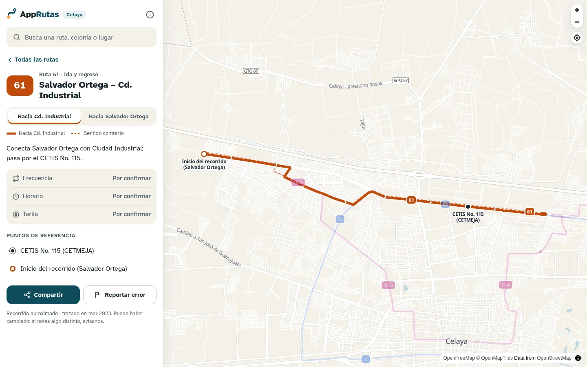
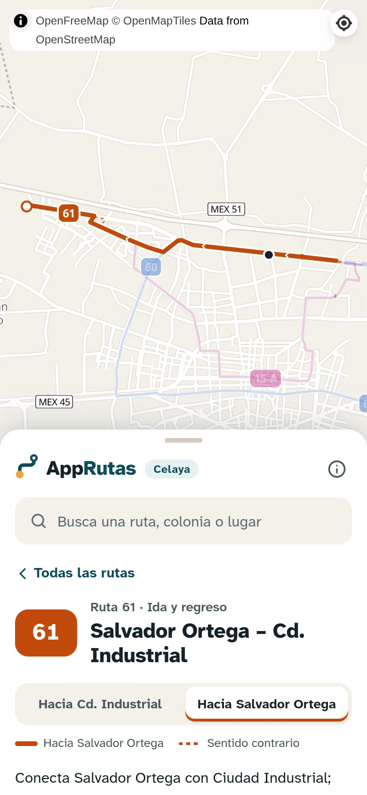

<p align="center">
  
</p>

<h1 align="center">AppRutas</h1>
<p align="center"><strong>Toma la ruta correcta.</strong><br />Los recorridos del camión urbano de Celaya, Guanajuato, en una web app rápida, gratuita e instalable.</p>

---

Más de 210 mil personas usan las rutas de camión en Celaya todos los días, y para muchas no es claro qué ruta tomar, por dónde
pasa o dónde bajarse. AppRutas reúne los recorridos en un mapa claro que funciona en cualquier teléfono, incluso sin conexión
después de la primera visita.

<p align="center">
  
  
</p>

## Qué hace

- **63 rutas** (38 urbanas y 25 suburbanas) con sus **755 paradas oficiales**, cada ruta con su color y su número sobre la línea.
- **Búsqueda** por número (`47`, `15a`), colonia, lugar o nombre de parada, sin importar acentos.
- **¿Qué ruta me deja cerca?** Busca un lugar (una escuela, un hospital, una calle) o toca el mapa: te dice qué rutas pasan
  más cerca, a cuántos metros, cuánto caminarías y en qué parada bajarte.
- **Ficha de cada ruta:** sentido de ida o regreso con flechas, paradas en orden, frecuencia, horario y tarifa.
- **“Pasan por aquí”:** toca el mapa donde se juntan varias rutas y te dice cuáles son.
- **Enlaces para compartir** (`…/#/ruta/61/regreso`), ideales para WhatsApp.
- **PWA:** se instala como app y abre sin internet. Funciona en celulares de gama baja.

## Cómo correrla

Requiere Node.js 22 o más reciente.

```bash
npm install
npm run dev        # http://localhost:5173
npm test           # pruebas (búsqueda, navegación, datos, importador)
npm run build      # versión de producción en dist/
npm run preview    # sirve dist/ para probarla
```

## Cómo está hecha

| Parte | Elección | Por qué |
|---|---|---|
| App | TypeScript + [Vite](https://vite.dev), sin framework | La app es pequeña: unos 12 KB comprimidos antes del mapa |
| Mapa | [MapLibre GL JS](https://maplibre.org) + [OpenFreeMap](https://openfreemap.org) | Libre, sin clave de API ni costo por uso, con estilo propio |
| Datos | GeoJSON en `data/rutas/` y `data/paradas.geojson`, validado al compilar | Editable a mano, revisable en git y GitHub lo muestra como mapa |
| Lugares | [Photon](https://photon.komoot.io) (komoot, datos de OpenStreetMap) | Gratis, sin clave y hecho para buscar mientras escribes; la cercanía a las rutas se calcula en el teléfono |
| PWA | [vite-plugin-pwa](https://vite-pwa-org.netlify.app) (Workbox) | Funciona sin conexión; también guarda las teselas del mapa |
| Hospedaje | GitHub Pages (`.github/workflows/publicar.yml`) | Gratis; se publica solo en cada push a `main` |

```
data/rutas/        una ruta por archivo (fuente de verdad)
data/paradas.geojson  paradas oficiales (se asocian a cada ruta al compilar)
data/fuentes/      copia de los datos del IMIPE Celaya (2021) y correcciones
data/kml-original/ trazos de Google My Maps de 2023
scripts/           importar KML, validar/compilar datos, generar íconos
src/               app (mapa/, ui/, búsqueda, navegación)
marca/             logo y símbolo en SVG
docs/              identidad visual
tests/             pruebas con Vitest
```

- **Agregar o corregir rutas:** [`data/README.md`](data/README.md)
- **Logo, colores y tipografía:** [`docs/identidad-visual.md`](docs/identidad-visual.md)

## Hoja de ruta

1. ✅ **Rediseño:** nueva identidad, mapa propio, búsqueda, ficha por ruta, PWA. Rutas 60, 61 y 15-A migradas.
2. ✅ **Todas las rutas oficiales:** 61 rutas y 774 paradas del IMIPE Celaya (2021) más las trazadas por el equipo.
3. Verificar y actualizar recorridos (cambios desde 2021), “rutas cerca de mí”, líneas paralelas donde varias rutas comparten
   calle, modo oscuro, exportación a GTFS, formulario de reportes.
4. Planeador de viajes: “¿cómo llego de A a B?”, con transbordos (ya existe “¿qué ruta me deja cerca?”).

## Créditos

Proyecto nacido en 2023 en la especialidad de Programación (6°G, generación 2020–2023) del CETIS No. 115 “Mexicano Japonés”, por:

- Orozco Paniagua Asaf Sebastian
- Jiménez Cortés Julián Moisés
- Hernandez Gallegos Cinthya Noely

La versión original en Laravel se conserva en la rama [`legacy`](../../tree/legacy).

Rutas y paradas oficiales: [IMIPE Celaya](https://imipecelaya.org/cartografia-celaya/), Sistema de Información Geográfica
Municipal (datos de 2021); ver [`data/fuentes/imipe-2021/LEEME.md`](data/fuentes/imipe-2021/LEEME.md). Mapa base © colaboradores
de [OpenStreetMap](https://www.openstreetmap.org/copyright), servido por OpenFreeMap.
